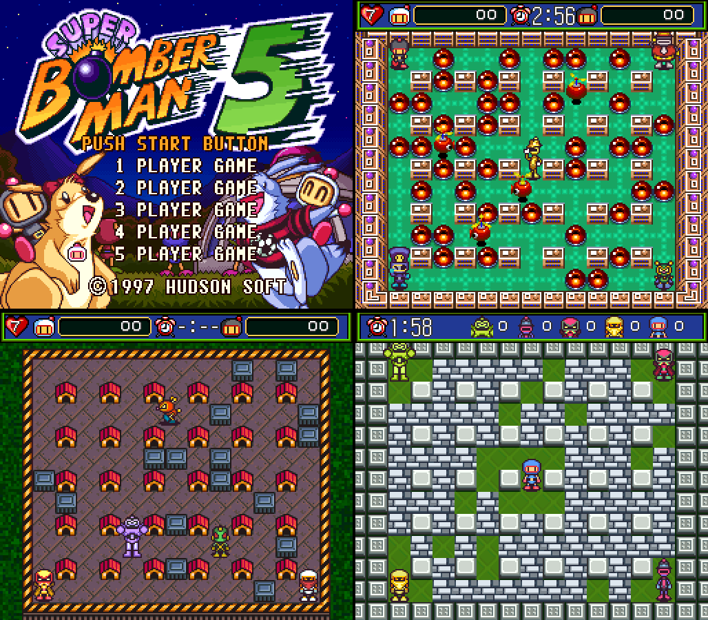
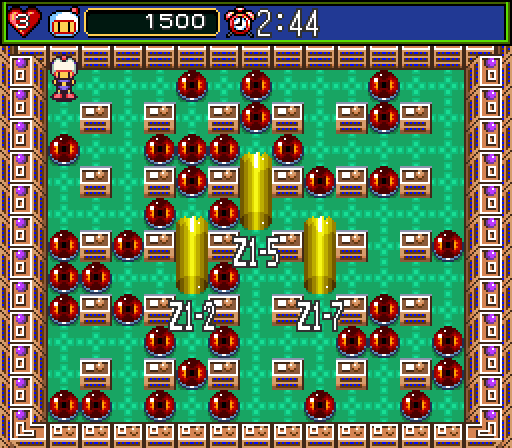

# Super Bomberman 5 Recompiled

An unofficial, noncommercial **Super Bomberman 5** PC port built with [SNESRecomp](https://github.com/RetroPortingToolKit/snesrecomp) and [recomp-ui](https://github.com/RetroPortingToolKit/recomp-ui), following the game-repository architecture of [Mega Man X Recompiled](https://github.com/mstan/MegaManXSNESRecomp).

[Download v1.0.1](https://github.com/MauricioSuporte/SuperBomberman5SNESRecomp/releases/tag/v1.0.1) · [English](#english) · [Português](#português) · [Technical status](docs/STATUS.md) · [Contributing](CONTRIBUTING.md)

> **Partial recompilation.** Most game logic still runs on the framework's interpreter. Supply your own legally obtained ROM; no ROM, generated game code or extracted assets are distributed. v1.0.1 is the first full release: the maintainer has played the campaign through to the end on Windows.

<p align="center"></p>

## English

### Highlights

- Windows x64 setup and an experimental Linux x86_64 AppImage; the game is generated and compiled locally from your ROM.
- Launcher with **PLAYER 1–5** input tabs (keyboard or gamepad per player, including several identical controllers such as two DualSense pads).
- Twelve optional mods, all disabled by default: five-player Normal Game, character and color selection in Normal, extra characters, Super Bomberman 4 Bomber Kings, Louie improvements, PT-BR menus and more.

### Install

1. Download **superbomberman5-1.0.1-windows-x64.zip** (Windows 10+ x64) or **superbomberman5-1.0.1-linux-x86_64.AppImage** (glibc 2.35+, Ubuntu 22.04 baseline) from [v1.0.1](https://github.com/MauricioSuporte/SuperBomberman5SNESRecomp/releases/tag/v1.0.1) and check **SHA256SUMS**.
2. Windows: extract the **entire** ZIP into a new writable folder and open `SuperBomberman5Recomp.exe`. Linux: `chmod +x` the AppImage and run it (without FUSE, add `--appimage-extract-and-run`); its setup lives in `~/.local/share/superbomberman5/1.0.1`.
3. Let the launcher fetch the portable build tools (internet needed once; Rust is not required), select your own ROM and choose **Generate & rebuild**.
4. Open **Mods** to enable features, configure controls and select **Play**.

**Upgrading:** install 1.0.1 into a new folder and run **Generate & rebuild** again; an older generated executable cannot load new native mod code. Leave several GB free.

### Supported ROM

Compatibility is decided by hash, not filename. The developer's file is named `Super Bomberman 5 (USA).sfc`, but its header reports **JPN**. Other revisions and translations are not qualified. [rom_identity.txt](rom_identity.txt) is authoritative; no ROM links are provided.

| Identity | Value |
|---|---|
| Header title | `Hu SUPER BOMBERMAN 5` |
| Mapping / ROM / SRAM | Fast HiROM / 4 MiB / 8 KiB |
| CRC32 | `c25ab56a` |
| SHA-256 | `5251e6491872dc51879b630a34d76a92e29ea0c39026c4f8773c1fe006d047c4` |

### Mods

Each setup package already includes these mods (no separate download). They can be enabled together; the full combination is not qualified.

| Mod | What it does |
|---|---|
| **Normal Game — five players** | 1–5 player campaign with shared lives (players + 2), Start to rejoin, items carried over per seat. [Details](docs/NORMAL_COOP.md) |
| **Normal Game — character selection** | Battle character picker after choosing a Normal save file. [Details](docs/NORMAL_CHARACTERS.md) |
| **Character selection — color controls** | Six palettes per character with L/R (keyboard C/V, gamepad LB/RB). [Details](docs/SELECTION_COLORS.md) |
| **Super Bomberman 5 Extra Characters** | Seven-column picker with Honey, Kotetsu, Subordinate Bomber and Emperor Terrorin, each with a B + direction ability. [Details](docs/EXTRA_CHARACTERS.md) |
| **Bomber Kings — Super Bomberman 4 characters** | Third picker row with SB4's Bomberman, Hammer, Jet, Lady, Bazooka and Great Bomber, read from **your own SB4 ROM**, with their SB4 abilities. [Details](docs/BOMBER_KINGS.md) |
| **Normal Game HUD faces** | Selected character and color in the P1/P2 HUD faces. [Details](docs/NORMAL_HUD_FACES.md) |
| **Louie improvements** | Yellow bomb kicks, Red enemy freeze and Black Louie's protected dash (Y). [Details](docs/LOUIE_IMPROVEMENTS.md) |
| **Normal Game — portal destinations** | Shows each visible portal's destination (`Z1-2`, `Z1-S`, `Z1-A1`…). [Details](docs/PORTAL_LABELS.md) |
| **Normal Game — infinite time** | Native `-:--` timer without timeout deaths. [Details](docs/INFINITE_TIME.md) |
| **Pause — exit & draw** | Return to the map in Normal; force a draw or return to stage select in Battle. [Details](docs/PAUSE_MENU.md) |
| **Gold Cartridge — Battle** | Arenas 11–13 and Hyper Revenge. [Details](docs/GOLD_BATTLE.md) |
| **Português brasileiro — menus** | PT-BR menus, HUD and certificates using the cartridge fonts. [Details](docs/TRANSLATION_PTBR.md) |



### Controls

| Keyboard | SNES |
|---|---|
| Arrow keys | D-pad |
| Enter / Right Shift | Start / Select |
| X / Z | A / B |
| S / A | X / Y |
| C / V | L / R |

Remap in the launcher. Each **PLAYER** tab chooses Keyboard or Gamepad and a device; identical controllers are listed separately (`DualSense (2)`). Players 3–5 start unassigned: give each its own gamepad or keys.

### Build from source

Install Git for Windows and Python 3.11+, then:

```powershell
git clone --recurse-submodules https://github.com/MauricioSuporte/SuperBomberman5SNESRecomp.git
cd SuperBomberman5SNESRecomp
./tools/setup-windows.ps1
./tools/build-windows.ps1 -Regenerate -Rom 'C:/roms/your-game.sfc'
```

Then open `SuperBomberman5Recomp.exe` at the repository root. Tools go to the ignored `.tools/` folder. See [BUILD_WINDOWS.md](docs/BUILD_WINDOWS.md). Never hand-edit or commit `src/gen/`.

### Status and limits

SNESRecomp translates analyzable 65816 routines into C and runs the rest through an interpreter, with PPU, APU, DMA and cartridge hardware modeled. AOT coverage is small and reset/NMI remain interpreted. Gameplay is verified with scripted routes on Linux LLE and maintainer play on Windows, including a full campaign playthrough; all mod combinations, physical five-player play and broad Linux compatibility are not qualified. No netplay, widescreen or macOS. Details: [STATUS.md](docs/STATUS.md).

[Open an issue](https://github.com/MauricioSuporte/SuperBomberman5SNESRecomp/issues) with version, OS, ROM hash and steps to reproduce. Never upload the ROM, extracted assets or save states.

### Credits and license

Thanks to Matthew Stanley and the RetroPorting ToolKit contributors for SNESRecomp and recomp-ui, and to Mega Man X Recompiled for the architecture reference. Project software uses [PolyForm Noncommercial 1.0.1](LICENSE); dependency notices are in [THIRD_PARTY_NOTICES.md](THIRD_PARTY_NOTICES.md). The license does not cover the Super Bomberman 5 ROM or game content. Not affiliated with or endorsed by the game's rights holders. AI agent guidance lives in [AGENTS.md](AGENTS.md).

## Português

### Destaques

- Setup Windows x64 e AppImage Linux x86_64 experimental; o jogo é gerado e compilado localmente a partir da sua ROM.
- Launcher com abas **PLAYER 1–5** (teclado ou controle por jogador, inclusive vários controles iguais, como dois DualSense).
- Doze mods opcionais, desligados por padrão: Normal Game com cinco jogadores, seleção de personagem e cor no Normal, personagens extras, Reis Bomber do Super Bomberman 4, melhorias dos Louies, menus em PT-BR e mais.

### Instalação

1. Baixe **superbomberman5-1.0.1-windows-x64.zip** (Windows 10+ x64) ou **superbomberman5-1.0.1-linux-x86_64.AppImage** (glibc 2.35+, base Ubuntu 22.04) na [v1.0.1](https://github.com/MauricioSuporte/SuperBomberman5SNESRecomp/releases/tag/v1.0.1) e confira o **SHA256SUMS**.
2. Windows: extraia o ZIP **inteiro** numa pasta nova e gravável e abra `SuperBomberman5Recomp.exe`. Linux: dê `chmod +x` no AppImage e execute (sem FUSE, use `--appimage-extract-and-run`); o setup fica em `~/.local/share/superbomberman5/1.0.1`.
3. Deixe o launcher baixar as ferramentas portáteis (internet só na primeira vez; Rust não é necessário), escolha sua própria ROM e clique em **Generate & rebuild**.
4. Abra **Mods** para ativar funções, configure os controles e clique em **Play**.

**Atualizando:** instale a 1.0.1 numa pasta nova e faça **Generate & rebuild** de novo; um executável gerado antigo não carrega o código nativo novo. Deixe alguns GB livres.

### ROM compatível

A compatibilidade é definida pelo hash da tabela em [Supported ROM](#supported-rom), não pelo nome do arquivo. O arquivo do desenvolvedor tem “USA” no nome, mas o cabeçalho indica **JPN**. Outras revisões e traduções não foram qualificadas. Nenhuma ROM acompanha o projeto.

### Mods

Todos já vêm no pacote de setup (sem download separado) e podem ser ativados juntos; a combinação completa não foi qualificada.

| Mod | O que faz |
|---|---|
| **Normal Game — five players** | Campanha de 1 a 5 jogadores com vidas compartilhadas (jogadores + 2), Start para voltar e itens mantidos por jogador. [Detalhes](docs/NORMAL_COOP.md) |
| **Normal Game — character selection** | Seletor de personagens do Battle depois de escolher o arquivo do Normal. [Detalhes](docs/NORMAL_CHARACTERS.md) |
| **Character selection — color controls** | Seis paletas por personagem com L/R (teclado C/V, controle LB/RB). [Detalhes](docs/SELECTION_COLORS.md) |
| **Super Bomberman 5 Extra Characters** | Seleção de sete colunas com Honey, Kotetsu, Subordinate Bomber e imperador Terrorin, cada um com habilidade em B + direção. [Detalhes](docs/EXTRA_CHARACTERS.md) |
| **Bomber Kings — Super Bomberman 4 characters** | Terceira fileira com Bomberman, Hammer, Jet, Lady, Bazooka e Great Bomber do SB4, lidos da **sua própria ROM do SB4**, com as habilidades do SB4. [Detalhes](docs/BOMBER_KINGS.md) |
| **Normal Game HUD faces** | Personagem e cor escolhidos nos rostos da HUD de P1/P2. [Detalhes](docs/NORMAL_HUD_FACES.md) |
| **Louie improvements** | Chute de bombas do Yellow, paralisia de inimigos do Red e arrancada protegida do Black Louie (Y). [Detalhes](docs/LOUIE_IMPROVEMENTS.md) |
| **Normal Game — portal destinations** | Mostra o destino de cada portal visível (`Z1-2`, `Z1-S`, `Z1-A1`…). [Detalhes](docs/PORTAL_LABELS.md) |
| **Normal Game — infinite time** | Cronômetro nativo `-:--` sem morte por tempo. [Detalhes](docs/INFINITE_TIME.md) |
| **Pause — exit & draw** | Voltar ao mapa no Normal; empatar a rodada ou voltar às arenas no Battle. [Detalhes](docs/PAUSE_MENU.md) |
| **Gold Cartridge — Battle** | Arenas 11–13 e Revanche Hiper. [Detalhes](docs/GOLD_BATTLE.md) |
| **Português brasileiro — menus** | Menus, HUD e certificados em PT-BR com as fontes do cartucho. [Detalhes](docs/TRANSLATION_PTBR.md) |

### Controles

**Setas** = direcional, **Enter** = Start, **Shift direito** = Select, **X/Z** = A/B, **S/A** = X/Y, **C/V** = L/R. Remapeie no launcher. Cada aba **PLAYER** escolhe Teclado ou Gamepad e o dispositivo; controles iguais aparecem separados (`DualSense (2)`). P3–P5 começam sem dispositivo: dê a cada um seu próprio controle ou teclas.

### Compilar

Instale Git for Windows e Python 3.11+ e execute os comandos de [Build from source](#build-from-source); depois abra `SuperBomberman5Recomp.exe` na raiz do repositório. Veja [BUILD_WINDOWS.md](docs/BUILD_WINDOWS.md) e [CONTRIBUTING.md](CONTRIBUTING.md).

### Estado e limites

A recompilação é parcial: rotinas analisáveis viram C e o restante roda no interpretador; reset/NMI continuam interpretados. A jogabilidade é verificada com rotas roteirizadas no Linux LLE e testes do mantenedor no Windows, que já zerou a campanha; todas as combinações de mods, cinco controles físicos e compatibilidade ampla no Linux não foram qualificados. Sem netplay, widescreen ou macOS. Detalhes em [STATUS.md](docs/STATUS.md).

[Abra uma issue](https://github.com/MauricioSuporte/SuperBomberman5SNESRecomp/issues) com versão, sistema, hash da ROM e passos. Nunca publique ROM, recursos extraídos ou save states.

O software usa [PolyForm Noncommercial 1.0.1](LICENSE), preservando as licenças das dependências ([THIRD_PARTY_NOTICES.md](THIRD_PARTY_NOTICES.md)). A licença não cobre a ROM nem o conteúdo de Super Bomberman 5. O projeto não tem vínculo ou endosso dos titulares do jogo.
