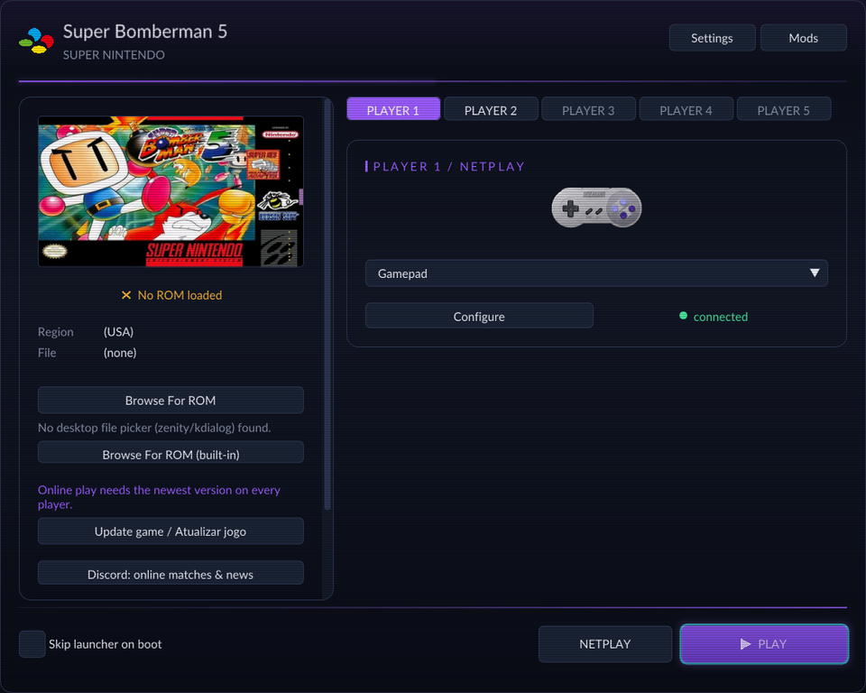

# Super Bomberman 5 Recompiled

An unofficial, noncommercial **Super Bomberman 5** PC port built with [SNESRecomp](https://github.com/RetroPortingToolKit/snesrecomp) and [recomp-ui](https://github.com/RetroPortingToolKit/recomp-ui), following the game-repository architecture of [Mega Man X Recompiled](https://github.com/mstan/MegaManXSNESRecomp).

[Download v2.2.3](https://github.com/MauricioSuporte/SuperBomberman5SNESRecomp/releases/tag/v2.2.3) · [English](#english) · [Português](#português) · [Technical status](docs/STATUS.md) · [Contributing](CONTRIBUTING.md)

> **Partial recompilation.** Most game logic still runs on the framework's interpreter. Supply your own legally obtained ROM; no ROM, generated game code or extracted assets are distributed. v1.0.1 is the first full release: the maintainer has played the campaign through to the end on Windows.

<p align="center"></p>

## English

### Highlights

- Windows x64 setup and an experimental Linux x86_64 AppImage; the game is generated and compiled locally from your ROM.
- Launcher with **PLAYER 1–5** input tabs (keyboard or gamepad per player, including several identical controllers such as two DualSense pads).
- Fourteen optional mods, all disabled by default: five-player Normal Game (with an optional corner spawn layout), character and color selection in Normal, extra characters, Super Bomberman 4 Bomber Kings, Louie improvements, PT-BR menus, a **Cheats** group (infinite time and infinite lives) and more.
- **New in v2.0.0 — netplay:** play online (lobby with Discord sign-in, rooms for all five players) or over LAN / Direct IP, like Mega Man X Recompiled. [Details](docs/NETPLAY.md)
- **Discord:** the launcher links to the Super Bomberman 5 server to find matches and follow news: <https://discord.gg/kH54NCDQB4>. With the Discord app open, your profile shows what you are playing and friends can join your online room from an invite.
- **Updater:** **Update game** in the launcher installs the newest release in place (checksum-verified, keeps your ROM, saves and settings). [Details](docs/UPDATER.md)
- Box art on the launcher's ROM panel, and releases listable in [Quiver Launcher](docs/QUIVER.md).

### Install

1. Download **superbomberman5-2.2.3-windows-x64.zip** (Windows 10+ x64) or **superbomberman5-2.2.3-linux-x86_64.AppImage** (glibc 2.35+, Ubuntu 22.04 baseline) from [v2.2.3](https://github.com/MauricioSuporte/SuperBomberman5SNESRecomp/releases/tag/v2.2.3) and check **SHA256SUMS**.
2. Windows: extract the **entire** ZIP into a new writable folder and open `SuperBomberman5Recomp.exe`. Linux: `chmod +x` the AppImage and run it (without FUSE, add `--appimage-extract-and-run`); its setup lives in `~/.local/share/superbomberman5/2.2.3`.
3. Let the launcher fetch the portable build tools (internet needed once; Rust is not required), select your own ROM and choose **Generate & rebuild**.
4. Open **Mods** to enable features, configure controls and select **Play**.

**Upgrading:** the launcher header shows your version and, when a newer release exists, the launcher says so (and holds online hosting until you update). From v2.0.0 on, use **Update game / Atualizar jogo** in the launcher (or `updater/SuperBomberman5Updater`), then run **Generate & rebuild** once; your ROM path, saves, settings and Mods selection are kept. From v1.x, install 2.2.3 into a new folder (or extract it over the old one) and run **Generate & rebuild** again; an older generated executable cannot load new native mod code. Leave several GB free.

### Supported ROM

Compatibility is decided by hash, not filename. The supported version is **Super Bomberman 5 (USA)** (`Super Bomberman 5 (USA).sfc`); its internal header still carries the Japanese region byte, so tools may label it JPN. Other revisions and translations are not qualified. [rom_identity.txt](rom_identity.txt) is authoritative; no ROM links are provided.

| Identity | Value |
|---|---|
| Header title | `Hu SUPER BOMBERMAN 5` |
| Mapping / ROM / SRAM | Fast HiROM / 4 MiB / 8 KiB |
| CRC32 | `c25ab56a` |
| SHA-256 | `5251e6491872dc51879b630a34d76a92e29ea0c39026c4f8773c1fe006d047c4` |

### Mods

Each setup package already includes these mods (no separate download). They can be enabled together; the full combination is not qualified.

| Mod | What it does |
|---|---|
| **Normal Game — five players** | 1–5 player campaign with shared lives (players + 2), Start to rejoin, items carried over per seat. P3/P5 start next to P1 and P4 next to P2. Listed under **Mods → 5 Players**. [Details](docs/NORMAL_COOP.md) |
| **Normal Game — five players: corner spawns** | With the five-player mod: P3 starts in the lower-left corner, P4 in the lower-right corner and P5 in the centre of regular stages. [Details](docs/NORMAL_COOP.md) |
| **Normal Game — character selection** | Battle character picker after choosing a Normal save file. [Details](docs/NORMAL_CHARACTERS.md) |
| **Character selection — color controls** | Six palettes per character with L/R (keyboard C/V, gamepad LB/RB). [Details](docs/SELECTION_COLORS.md) |
| **Super Bomberman 5 Extra Characters** | Seven-column picker with Honey, Kotetsu, Subordinate Bomber and Emperor Terrorin, each with a B + direction ability. [Details](docs/EXTRA_CHARACTERS.md) |
| **Bomber Kings — Super Bomberman 4 characters** | Third picker row with SB4's Bomberman, Hammer, Jet, Lady, Bazooka and Great Bomber, read from **your own SB4 ROM**, with their SB4 abilities. [Details](docs/BOMBER_KINGS.md) |
| **Normal Game HUD faces** | Selected character and color in the P1/P2 HUD faces. [Details](docs/NORMAL_HUD_FACES.md) |
| **Louie improvements** | Yellow bomb kicks, Red enemy freeze and Black Louie's protected dash (Y). [Details](docs/LOUIE_IMPROVEMENTS.md) |
| **Normal Game — portal destinations** | Shows each visible portal's destination (`Z1-2`, `Z1-S`, `Z1-A1`…). [Details](docs/PORTAL_LABELS.md) |
| **Normal Game — infinite time** | Native `-:--` timer without timeout deaths. Listed under **Mods → Cheats**. [Details](docs/INFINITE_TIME.md) |
| **Normal Game — infinite lives** | Lives are never spent (deaths, retries, five-player rejoins): no Game Over. **Mods → Cheats**. [Details](docs/INFINITE_LIVES.md) |
| **Pause — exit & draw** | Return to the map in Normal; force a draw or return to stage select in Battle. [Details](docs/PAUSE_MENU.md) |
| **Gold Cartridge — Battle** | Arenas 11–13 and Hyper Revenge. [Details](docs/GOLD_BATTLE.md) |
| **Português brasileiro — menus** | PT-BR menus, HUD and certificates using the cartridge fonts. [Details](docs/TRANSLATION_PTBR.md) |


### Netplay, Discord and updates

- **NETPLAY → Online Netplay** finds rooms on the shared lobby server (sign in with Discord); **LAN / Direct IP** needs no account. Everyone needs the same version and their own ROM; the room adopts the host's mods. Synchronization is lockstep (delay-sync). **Tested successfully in a real online match (2026-10-23)**, together with the Discord integration (status, invites and joining rooms). Three or more peers are not yet qualified. Find players and report results on the [Super Bomberman 5 Discord](https://discord.gg/kH54NCDQB4). [Details](docs/NETPLAY.md)
- **New in v2.2.0 — Discord status and invites:** with the Discord app open, your profile shows that you are playing and what you are doing (launcher, online room, Normal Game, Battle). While you are in an online room it appears in Discord as a party: invite friends with **+ → Invite to play** in a chat, and when they click **Join** their launcher opens Online Netplay and enters your room (Ask to Join is accepted while a seat is free; on Windows Discord starts the game if it is closed). Password, full and LAN rooms are not published. Tested with the real Discord client. **New in v2.2.2 — Copy Invite:** the button in an online room's footer copies a message with the room code for any chat; a friend copies it and presses **Join from Invite** on the Online Netplay page. [Details](docs/DISCORD.md#english) · [Terms](docs/TERMS_OF_SERVICE.md) · [Privacy](docs/PRIVACY_POLICY.md)
- **New in v2.1.0 — chat and names in the match:** during an online match the room's chat stays in the game, bottom-left: new lines show for 5 seconds, **T** opens the text bar with the history that fits, **Enter** sends, **Esc** cancels (the keyboard does not move your bomber while you type; a gamepad keeps playing). Each player's room name floats over the bomber they control while it is on the field and alive. People who enter the room while a match is running wait there, chat with the players and play from the next match. Not yet tried in a real internet match. [Details](docs/NETPLAY.md#english)
- **Discord: online matches & news** opens the [Super Bomberman 5 Discord server](https://discord.gg/kH54NCDQB4).
- **Update game** downloads the newest release from GitHub, verifies it against `SHA256SUMS` and installs it in place. [Details](docs/UPDATER.md)
- [Quiver Launcher](https://github.com/tgeorgiadis/quiver-launcher) can install and update the releases; see [QUIVER.md](docs/QUIVER.md).

<p align="center"></p>

### Controls

| Keyboard | SNES |
|---|---|
| Arrow keys | D-pad |
| Enter / Right Shift | Start / Select |
| X / Z | A / B |
| S / A | X / Y |
| C / V | L / R |

Remap in the launcher. Each **PLAYER** tab chooses Keyboard or Gamepad and a device; identical controllers are listed separately (`DualSense (2)`). Players 3–5 start unassigned: give each its own gamepad or keys.

### Build from source

Install Git for Windows and Python 3.11+, then:

```powershell
git clone --recurse-submodules https://github.com/MauricioSuporte/SuperBomberman5SNESRecomp.git
cd SuperBomberman5SNESRecomp
./tools/setup-windows.ps1
./tools/build-windows.ps1 -Regenerate -Rom 'C:/roms/your-game.sfc'
```

Then open `SuperBomberman5Recomp.exe` at the repository root. Tools go to the ignored `.tools/` folder. See [BUILD_WINDOWS.md](docs/BUILD_WINDOWS.md). Never hand-edit or commit `src/gen/`.

### Status and limits

SNESRecomp translates analyzable 65816 routines into C and runs the rest through an interpreter, with PPU, APU, DMA and cartridge hardware modeled. AOT coverage is small and reset/NMI remain interpreted. Gameplay is verified with scripted routes on Linux LLE and maintainer play on Windows, including a full campaign playthrough; all mod combinations, physical five-player play and broad Linux compatibility are not qualified. Netplay is new in v2.0.0; it was tested successfully in a real two-player online match, and three or more peers are not qualified. No widescreen or macOS. Details: [STATUS.md](docs/STATUS.md).

[Open an issue](https://github.com/MauricioSuporte/SuperBomberman5SNESRecomp/issues) with version, OS, ROM hash and steps to reproduce. Never upload the ROM, extracted assets or save states.

### Credits and license

Thanks to Matthew Stanley and the RetroPorting ToolKit contributors for SNESRecomp and recomp-ui, and to Mega Man X Recompiled for the architecture reference. Project software uses [PolyForm Noncommercial 1.0.1](LICENSE); dependency notices are in [THIRD_PARTY_NOTICES.md](THIRD_PARTY_NOTICES.md). The license does not cover the Super Bomberman 5 ROM or game content. Not affiliated with or endorsed by the game's rights holders. AI agent guidance lives in [AGENTS.md](AGENTS.md).

## Português

### Destaques

- Setup Windows x64 e AppImage Linux x86_64 experimental; o jogo é gerado e compilado localmente a partir da sua ROM.
- Launcher com abas **PLAYER 1–5** (teclado ou controle por jogador, inclusive vários controles iguais, como dois DualSense).
- Quatorze mods opcionais, desligados por padrão: Normal Game com cinco jogadores (com layout opcional de spawn nos cantos), seleção de personagem e cor no Normal, personagens extras, Reis Bomber do Super Bomberman 4, melhorias dos Louies, menus em PT-BR, o grupo **Cheats** (tempo infinito e vidas infinitas) e mais.
- **Novo na v2.0.0 — netplay:** jogue online (lobby com login do Discord, salas para os cinco jogadores) ou por LAN / IP direto, como no Mega Man X Recompiled. [Detalhes](docs/NETPLAY.md)
- **Discord:** o launcher leva ao servidor do Super Bomberman 5 para achar partidas e acompanhar novidades: <https://discord.gg/kH54NCDQB4>. Com o app do Discord aberto, o seu perfil mostra o que você está jogando e amigos entram na sua sala online por convite.
- **Atualizador:** **Atualizar jogo** no launcher instala a release mais nova na mesma pasta (conferida por checksum, mantendo ROM, saves e configurações). [Detalhes](docs/UPDATER.md)
- Capa do jogo no painel da ROM do launcher, e releases listáveis no [Quiver Launcher](docs/QUIVER.md).

### Instalação

1. Baixe **superbomberman5-2.2.3-windows-x64.zip** (Windows 10+ x64) ou **superbomberman5-2.2.3-linux-x86_64.AppImage** (glibc 2.35+, base Ubuntu 22.04) na [v2.2.3](https://github.com/MauricioSuporte/SuperBomberman5SNESRecomp/releases/tag/v2.2.3) e confira o **SHA256SUMS**.
2. Windows: extraia o ZIP **inteiro** numa pasta nova e gravável e abra `SuperBomberman5Recomp.exe`. Linux: dê `chmod +x` no AppImage e execute (sem FUSE, use `--appimage-extract-and-run`); o setup fica em `~/.local/share/superbomberman5/2.2.3`.
3. Deixe o launcher baixar as ferramentas portáteis (internet só na primeira vez; Rust não é necessário), escolha sua própria ROM e clique em **Generate & rebuild**.
4. Abra **Mods** para ativar funções, configure os controles e clique em **Play**.

**Atualizando:** o cabeçalho do launcher mostra a sua versão e, quando há versão mais nova, o launcher avisa (e segura a criação de salas online até você atualizar). A partir da v2.0.0, use **Update game / Atualizar jogo** no launcher (ou `updater/SuperBomberman5Updater`) e faça **Generate & rebuild** uma vez; o caminho da ROM, saves, configurações e mods escolhidos continuam. Vindo da v1.x, instale a 2.2.3 numa pasta nova (ou extraia por cima da antiga) e faça **Generate & rebuild** de novo; um executável gerado antigo não carrega o código nativo novo. Deixe alguns GB livres.

### ROM compatível

A compatibilidade é definida pelo hash da tabela em [Supported ROM](#supported-rom), não pelo nome do arquivo. A versão suportada é **Super Bomberman 5 (USA)** (`Super Bomberman 5 (USA).sfc`); o cabeçalho interno ainda traz o byte de região japonês, por isso algumas ferramentas a chamam de JPN. Outras revisões e traduções não foram qualificadas. Nenhuma ROM acompanha o projeto.

### Mods

Todos já vêm no pacote de setup (sem download separado) e podem ser ativados juntos; a combinação completa não foi qualificada.

| Mod | O que faz |
|---|---|
| **Normal Game — five players** | Campanha de 1 a 5 jogadores com vidas compartilhadas (jogadores + 2), Start para voltar e itens mantidos por jogador. P3/P5 nascem junto do P1 e P4 junto do P2. Fica em **Mods → 5 Players**. [Detalhes](docs/NORMAL_COOP.md) |
| **Normal Game — five players: corner spawns** | Com o mod de cinco jogadores: P3 nasce no canto inferior esquerdo, P4 no inferior direito e P5 no centro das fases comuns. [Detalhes](docs/NORMAL_COOP.md) |
| **Normal Game — character selection** | Seletor de personagens do Battle depois de escolher o arquivo do Normal. [Detalhes](docs/NORMAL_CHARACTERS.md) |
| **Character selection — color controls** | Seis paletas por personagem com L/R (teclado C/V, controle LB/RB). [Detalhes](docs/SELECTION_COLORS.md) |
| **Super Bomberman 5 Extra Characters** | Seleção de sete colunas com Honey, Kotetsu, Subordinate Bomber e imperador Terrorin, cada um com habilidade em B + direção. [Detalhes](docs/EXTRA_CHARACTERS.md) |
| **Bomber Kings — Super Bomberman 4 characters** | Terceira fileira com Bomberman, Hammer, Jet, Lady, Bazooka e Great Bomber do SB4, lidos da **sua própria ROM do SB4**, com as habilidades do SB4. [Detalhes](docs/BOMBER_KINGS.md) |
| **Normal Game HUD faces** | Personagem e cor escolhidos nos rostos da HUD de P1/P2. [Detalhes](docs/NORMAL_HUD_FACES.md) |
| **Louie improvements** | Chute de bombas do Yellow, paralisia de inimigos do Red e arrancada protegida do Black Louie (Y). [Detalhes](docs/LOUIE_IMPROVEMENTS.md) |
| **Normal Game — portal destinations** | Mostra o destino de cada portal visível (`Z1-2`, `Z1-S`, `Z1-A1`…). [Detalhes](docs/PORTAL_LABELS.md) |
| **Normal Game — infinite time** | Cronômetro nativo `-:--` sem morte por tempo. Fica em **Mods → Cheats**. [Detalhes](docs/INFINITE_TIME.md) |
| **Normal Game — infinite lives** | As vidas nunca são gastas (mortes, reinícios, volta com Start no modo de cinco): sem Game Over. **Mods → Cheats**. [Detalhes](docs/INFINITE_LIVES.md) |
| **Pause — exit & draw** | Voltar ao mapa no Normal; empatar a rodada ou voltar às arenas no Battle. [Detalhes](docs/PAUSE_MENU.md) |
| **Gold Cartridge — Battle** | Arenas 11–13 e Revanche Hiper. [Detalhes](docs/GOLD_BATTLE.md) |
| **Português brasileiro — menus** | Menus, HUD e certificados em PT-BR com as fontes do cartucho. [Detalhes](docs/TRANSLATION_PTBR.md) |

### Netplay, Discord e atualizações

- **NETPLAY → Online Netplay** procura salas no servidor de lobby compartilhado (entre com o Discord); **LAN / Direct IP** não precisa de conta. Todos precisam da mesma versão e da própria ROM; a sala adota os mods do anfitrião. A sincronização é lockstep (delay-sync). **Testado com sucesso numa partida online real (2026-10-23)**, junto com a integração com o Discord (status, convites e entrada nas salas). Três ou mais peers ainda não foram qualificados. Ache jogadores e conte como foi no [Discord do Super Bomberman 5](https://discord.gg/kH54NCDQB4). [Detalhes](docs/NETPLAY.md)
- **Novo na v2.2.0 — status e convites no Discord:** com o app do Discord aberto, o seu perfil mostra que você está jogando e o que está fazendo (launcher, sala online, Normal Game, Battle). Enquanto você está numa sala online, ela aparece no Discord como um grupo: convide amigos pelo **+ → Convidar para jogar** no chat e, quando eles clicarem em **Entrar**, o launcher deles abre o Online Netplay e entra na sua sala (o "Pedir para entrar" é aceito enquanto houver vaga; no Windows o Discord abre o jogo se ele estiver fechado). Salas com senha, cheias e LAN não são publicadas. Testado com o app do Discord de verdade. **Novo na v2.2.2 — Copy Invite:** o botão **Copy Invite** no rodapé da sala online copia uma mensagem com o código da sala para qualquer chat; o amigo copia e clica em **Join from Invite** na página do Online Netplay. [Detalhes](docs/DISCORD.md#português) · [Termos](docs/TERMS_OF_SERVICE.md) · [Privacidade](docs/PRIVACY_POLICY.md)
- **Novo na v2.1.0 — chat e nomes na partida:** durante uma partida online o chat da sala continua dentro do jogo, no canto inferior esquerdo: mensagens novas aparecem por 5 segundos, **T** abre a barra de texto com o histórico que couber, **Enter** envia, **Esc** cancela (enquanto você digita, o teclado não move o personagem; o controle continua jogando). O nome de cada jogador na sala aparece em cima do personagem que ele controla, enquanto estiver em cena e vivo. Quem entra na sala com a partida em andamento espera nela, conversa com os jogadores e joga a partir da partida seguinte. Ainda não testado numa partida real pela internet. [Detalhes](docs/NETPLAY.md#chat-no-jogo)
- **Discord: online matches & news** abre o [servidor do Super Bomberman 5 no Discord](https://discord.gg/kH54NCDQB4).
- **Atualizar jogo** baixa a release mais nova do GitHub, confere com o `SHA256SUMS` e instala na mesma pasta. [Detalhes](docs/UPDATER.md)
- O [Quiver Launcher](https://github.com/tgeorgiadis/quiver-launcher) instala e atualiza as releases; veja [QUIVER.md](docs/QUIVER.md).

### Controles

**Setas** = direcional, **Enter** = Start, **Shift direito** = Select, **X/Z** = A/B, **S/A** = X/Y, **C/V** = L/R. Remapeie no launcher. Cada aba **PLAYER** escolhe Teclado ou Gamepad e o dispositivo; controles iguais aparecem separados (`DualSense (2)`). P3–P5 começam sem dispositivo: dê a cada um seu próprio controle ou teclas.

### Compilar

Instale Git for Windows e Python 3.11+ e execute os comandos de [Build from source](#build-from-source); depois abra `SuperBomberman5Recomp.exe` na raiz do repositório. Veja [BUILD_WINDOWS.md](docs/BUILD_WINDOWS.md) e [CONTRIBUTING.md](CONTRIBUTING.md).

### Estado e limites

A recompilação é parcial: rotinas analisáveis viram C e o restante roda no interpretador; reset/NMI continuam interpretados. A jogabilidade é verificada com rotas roteirizadas no Linux LLE e testes do mantenedor no Windows, que já zerou a campanha; todas as combinações de mods, cinco controles físicos e compatibilidade ampla no Linux não foram qualificados. O netplay é novo na v2.0.0; foi testado com sucesso numa partida online real com dois jogadores, e três ou mais peers ainda não foram qualificados. Sem widescreen ou macOS. Detalhes em [STATUS.md](docs/STATUS.md).

[Abra uma issue](https://github.com/MauricioSuporte/SuperBomberman5SNESRecomp/issues) com versão, sistema, hash da ROM e passos. Nunca publique ROM, recursos extraídos ou save states.

O software usa [PolyForm Noncommercial 1.0.1](LICENSE), preservando as licenças das dependências ([THIRD_PARTY_NOTICES.md](THIRD_PARTY_NOTICES.md)). A licença não cobre a ROM nem o conteúdo de Super Bomberman 5. O projeto não tem vínculo ou endosso dos titulares do jogo.
